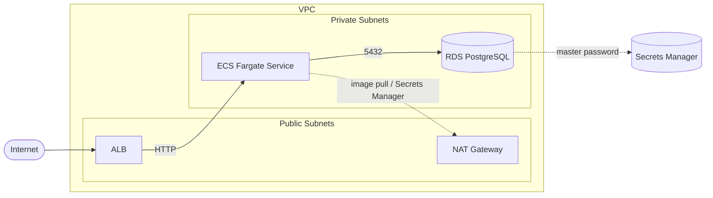
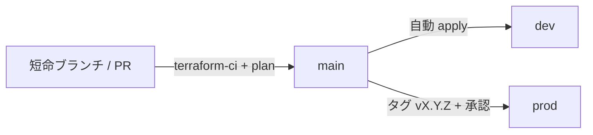

# aws-terraform-web-template

AWS 上の標準的な Web アプリ基盤（VPC / ALB / ECS Fargate / RDS PostgreSQL）を、Terraform + Terragrunt でコード化したテンプレートです。dev / prod の環境差分は tfvars だけで表現し、state 用 S3 バケットの事前作成は不要です。

## 構成図



## ディレクトリ構成

```text
.
├── main.tf / variables.tf / outputs.tf / versions.tf   # ルートモジュール（modules を呼び出す）
├── terragrunt.hcl        # state バックエンド自動作成 + 環境別 tfvars の切替
├── dev.tfvars            # dev 環境の差分（小規模・単一NAT・削除保護なし）
├── prod.tfvars           # prod 環境の差分（マルチAZ・NAT冗長・削除保護あり）
├── modules/
│   ├── vpc/              # VPC / Subnet / IGW / NAT / Route Table
│   ├── ecs/              # ALB / ECS Fargate / IAM 実行ロール / CloudWatch Logs
│   └── rds/              # RDS PostgreSQL / Subnet Group / Security Group
├── .devcontainer/        # terraform, terragrunt, tflint, aws cli, gh, git 入りの開発環境
├── tests/                # terraform test（モックプロバイダ）
├── bootstrap/github-oidc/ # GitHub Actions 用 OIDC / IAM ロール（初回のみ apply）
└── .github/              # workflows / dependabot / 共通セットアップ action
```

## 設計思想

- **最小権限**: Security Group は `Internet → ALB → ECS → RDS` の参照連鎖のみ許可。RDS は ECS の SG からの 5432 だけ受け付け、パブリックアクセス不可。VPC のデフォルト SG は全ルール削除。ECS の実行ロールは注入するシークレットの読み取りのみ追加許可。
- **機密情報をコードに置かない**: RDS のマスターパスワードは `manage_master_user_password` により Secrets Manager で管理し、ECS タスクへ Secrets として注入。
- **再利用性**: コンポーネントごとに `modules/` 化。環境差分は `dev.tfvars` / `prod.tfvars` のみで、ディレクトリを複製しない。
- **state 管理**: Terragrunt の `remote_state` が S3 バケット（バージョニング・暗号化有効）を自動作成。ロックは S3 ネイティブロック（`use_lockfile`、Terraform 1.10+）で、DynamoDB は不要。state キーは `<env>/terraform.tfstate` で環境ごとに分離。

## 使い方

### 1. 開発環境の起動

VS Code で開き、Dev Containers で「Reopen in Container」。terraform / terragrunt / tflint / aws cli / gh / git が利用できます。

```bash
gh auth login          # 必要に応じて
aws configure sso      # もしくは aws configure
export AWS_PROFILE=<your-profile>
```

### 2. 実行

環境は環境変数 `ENV`（既定 `dev`）で切り替えます。

```bash
ENV=dev  terragrunt plan
ENV=dev  terragrunt apply
ENV=prod terragrunt plan
```

初回実行時、`aws-tf-web-tfstate-<account_id>-<region>` バケットが無ければ Terragrunt が作成します。リージョンは `AWS_REGION` で変更できます（既定 `ap-northeast-1`）。

> ⚠️ `apply` すると NAT Gateway / ALB / RDS など課金されるリソースが作成されます。検証後は `ENV=dev terragrunt destroy` で削除してください。

### 3. 本番向けの機能（tfvars で切替）

| 機能 | 変数 | 内容 |
| --- | --- | --- |
| HTTPS | `domain_name` / `route53_zone_id` | 指定時のみ ACM 証明書（DNS 検証）+ 443 リスナー + 80→443 リダイレクト + Route53 エイリアス。未指定なら ALB への HTTP のみ |
| オートスケール | `desired_count`（最小）/ `max_capacity` | ECS サービスを CPU 60% 目標で増減（target tracking） |
| WAF | `enable_waf` | AWS マネージドルール（Common / KnownBadInputs / IP Reputation）を ALB に関連付け。prod は `true` |
| S3 エンドポイント | 常時有効 | S3 ゲートウェイエンドポイント（無料）で ECR レイヤ取得の NAT 通信料を削減 |

### 4. 注意点

- `domain_name` 未指定時は HTTP(80) のみです。公開する本番環境では必ずドメインを設定して HTTPS 化してください。
- 既定のコンテナイメージは `public.ecr.aws/nginx/nginx:stable` です。`container_image` を変更してアプリに差し替えます。

## CI/CD（トランクベース開発）

長命ブランチ（develop・環境別ブランチ）は持たず、`main` が常にデプロイ可能な唯一の幹です。作業は短命ブランチ（1〜2日）で行い、PR → squash merge で `main` に取り込みます。未完成の機能は変数（例: `enable_waf = false`）で無効のままマージします。



| ワークフロー | トリガー | 内容 |
| --- | --- | --- |
| `terraform-ci` | PR / main push | fmt・hcl fmt・validate・`terraform test`・tflint・trivy（AWS 認証不要）。結果は PR コメントに集約 |
| `terraform-plan` | PR | OIDC で dev / prod の `terragrunt plan` を実行し PR コメントに表示（読み取り専用ロール） |
| `terraform-deploy` | main push / タグ `v*` | main → dev へ apply（`AUTO_DEPLOY_DEV=true` の時のみ）、タグ → prod へ apply（Environment の承認が必要。タグが main 上のコミットであることも検証） |

環境ごとにブランチを切らず、**同じコミットを dev → prod へ昇格**させます。AWS の長期アクセスキーは使わず、GitHub OIDC で一時認証情報を取得します。

### CI/CD のセットアップ（初回のみ）

1. 管理者権限で OIDC 連携用の IAM を作成（state はローカル）。
   ```bash
   cd bootstrap/github-oidc && terraform init && terraform apply
   ```
2. 出力されたロール ARN をリポジトリ変数に登録。
   ```bash
   gh variable set AWS_PLAN_ROLE_ARN  --body "<plan_role_arn>"
   gh variable set AWS_APPLY_ROLE_ARN --body "<apply_role_arn>"
   gh variable set AWS_REGION         --body "ap-northeast-1"
   gh variable set AUTO_DEPLOY_DEV    --body "true"   # dev の自動デプロイを有効化する場合のみ
   ```
3. GitHub の Environments に `dev` / `prod` を作成。`prod` には必須レビュアーと「タグ `v*` のみ」のデプロイ制限を設定。
4. `main` のブランチ保護（PR 必須・`terraform-ci` 必須・linear history）と squash merge のみを有効化。

> 変数が未設定の間、plan / deploy ワークフローはスキップされます。apply ロールは検証用に `AdministratorAccess` ですが、引き受け可能なのは GitHub Environment 経由のジョブのみです。

### セキュリティスキャンの除外

`trivy` の指摘のうち意図的に許容しているものは `.trivyignore.yaml` に理由付きで記載しています（ALB の公開、HTTP リスナー、ECS の外向き通信）。

## 今後の予定

- GCP 版（`gcp-terraform-web-template`: Cloud Run / Cloud SQL）の追加
